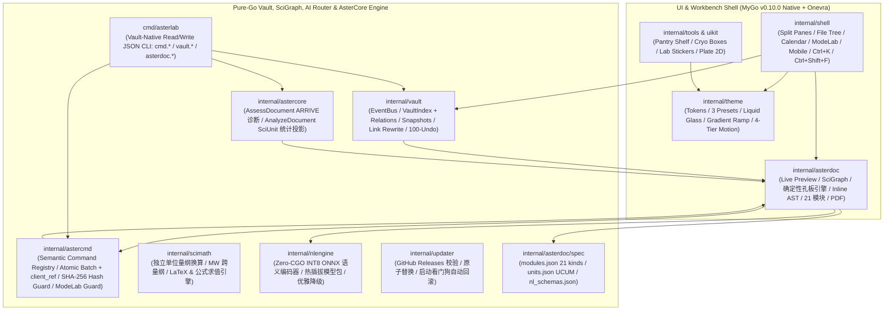

# 分层架构与代码包

AsterLab 采用「**`.asterml` 本地 Vault 单真源 × Pure-Go 统一科学核心（`astercore` + `astercmd`）**」架构，由 MyGo Native（`mygo@v0.10.0`）与 `onevra@v0.2026.18` 驱动桌面端与移动端无 WebView 原生运行；原 Rust Core 与 SQLite 路径已正式弃用，不再参与桌面端、移动端及 CLI 的运行与分发。

## 核心架构原则：单真源、Live Preview 与统一命令总线

1. **`.asterml` Vault 是唯一事实源，不引入格式级写锁**：实验文档以开放的 Markdown + YAML 围栏 + 行内 `{@...}` 关联语法直接存于用户目录下，兼容任意文本编辑器、Git、网盘、Obsidian 与外部 Agent 协同；防误触保护仅在软件层通过「实验模式（`ModeLab`）」实现，不绑定到文件格式本身。
2. **本地索引与幂等日志只是可丢弃重建的加速层**：`.asterlab/cache/index.json` 承担全文检索、反向链接、行内关系倒排、全库计时聚合与跨实验查询加速；`.asterlab/cache/cmd-journal.json` 缓存有界命令幂等回执；删除后不损失任何实验记录。
3. **Pure-Go 引擎统一人类交互与 Agent 读写**：Live Preview `/` 命令、`+` 按钮、右键菜单、移动端底条与 `cmd/asterlab` CLI 共用 `internal/astercmd` 语义命令总线（带 SHA-256 `expected_hash` 并发保护与 `client_ref` 批量原子事务）、`internal/asterdoc` 统一行内关联 AST 与 `internal/astercore` 确定性统计核心。

## `prototypes/mygo-run` 核心包索引

| 包路径 | 核心职责 | 关键源码入口 |
|---|---|---|
| 根目录 (`main`) | 应用启动、`asterlab://` 深度链接分发、纯白纸模板、Vault ⇄ Shell ⇄ `astercmd` ⇄ `astercore` 状态联动与 `UnifiedLive` 宿主画布 | [main.go](../../prototypes/mygo-run/main.go)、[vault_host.go](../../prototypes/mygo-run/vault_host.go)、[experiment_page.go](../../prototypes/mygo-run/experiment_page.go) |
| `internal/astercmd` | 人类与 Agent 共用的语义命令注册表（含 1 空白 + 4 轻量步骤预设）、批量原子执行器、`client_ref` 引用解析、SHA-256 `expected_hash` 并发保护、`ModeLab` 写守卫与幂等日志 | [registry.go](../../prototypes/mygo-run/internal/astercmd/registry.go)、[executor.go](../../prototypes/mygo-run/internal/astercmd/executor.go) |
| `internal/vault` | 本地 Vault 初始化、事件总线、增量全文/反向链接/行内关系/计时/Bases 索引缓存、File Recovery 快照、`local.json` 与 `LiveDocument` | [vault.go](../../prototypes/mygo-run/internal/vault/vault.go)、[live_doc.go](../../prototypes/mygo-run/internal/vault/live_doc.go)、[events.go](../../prototypes/mygo-run/internal/vault/events.go)、[index.go](../../prototypes/mygo-run/internal/vault/index.go) |
| `internal/astercore` | Pure Go 统一科学核心：分级结构与 ARRIVE 2.0 诊断、稀释越界拦截、基于 `SciUnit` 的多板/空白扣除/异常孔剔除 CCK-8 与 RT-qPCR ΔΔCq 统计投影 | [diagnostic.go](../../prototypes/mygo-run/internal/astercore/diagnostic.go)、[analyze.go](../../prototypes/mygo-run/internal/astercore/analyze.go) |
| `internal/scimath` | **独立科学单位与计算引擎（零 UI / 纯 stdlib）**：SI 物理量纲分类与自动换算、非法跨量纲阻断、`MW` 质量↔摩尔浓度换算、`C₁V₁=C₂V₂` 求解与统一算术/LaTeX 公式求值器 | [units.go](../../prototypes/mygo-run/internal/scimath/units.go)、[expr.go](../../prototypes/mygo-run/internal/scimath/expr.go) |
| `internal/nlengine` | 纯 Go 零 CGO 离线 INT8 ONNX 推理引擎、WordPiece 分词器、版本化模型包校验（`onnx_sha256`）与热升级目录发现 | [ort_windows.go](../../prototypes/mygo-run/internal/nlengine/ort_windows.go)、[manifest.go](../../prototypes/mygo-run/internal/nlengine/manifest.go)、[wordpiece.go](../../prototypes/mygo-run/internal/nlengine/wordpiece.go) |
| `internal/updater` | 应用内更新检查、SHA-256 与 PE 头校验、更新前本地数据备份、两阶段 `.old` 原子替换及启动看门狗自动回滚 | [updater.go](../../prototypes/mygo-run/internal/updater/updater.go)、[watchdog.go](../../prototypes/mygo-run/internal/updater/watchdog.go) |
| `cmd/asterlab` | 无头 Vault-native 读写 CLI（`--vault`），提供 `cmd.*`、`vault.*` 与 `asterdoc.{read,objects,relations,validate,preview,exec,assess,analyze}` | [cmd/asterlab/main.go](../../prototypes/mygo-run/cmd/asterlab/main.go) |
| `internal/shell` | 左 Ribbon + 文件树、平权分屏、三态视图（`ModeEdit`/`ModeLab`/`ModeSource`）、日历、`Ctrl+K`、`Ctrl+Shift+F`、底部状态栏、右抽屉与移动端单手壳 | [shell.go](../../prototypes/mygo-run/internal/shell/shell.go)、[tabs.go](../../prototypes/mygo-run/internal/shell/tabs.go)、[search_modal.go](../../prototypes/mygo-run/internal/shell/search_modal.go)、[hotkeys.go](../../prototypes/mygo-run/internal/shell/hotkeys.go)、[mobile.go](../../prototypes/mygo-run/internal/shell/mobile.go) |
| `internal/theme` | 唯一通用设计 Token 源、`LiquidGlass` 材质、`CategoricalPalette` / `GradientRampColor` 科学色板、缩放字体与 `ReduceMotion` 物理动效 | [theme.go](../../prototypes/mygo-run/internal/theme/theme.go)、[motion.go](../../prototypes/mygo-run/internal/theme/motion.go) |
| `internal/asterdoc` | AsterML 解析/校验、**`SciGraph` 单文档科学网络与 `SciUnit`**、跨计算器物理量纲换算、**确定性孔板排版引擎（`plate_layout.go`）**、离线 ONNX 语义路由与悬停预览、Obsidian Live Preview、统一行内关联 AST、21 模块渲染器与 PNG/PDF 导出 | [scigraph.go](../../prototypes/mygo-run/internal/asterdoc/scigraph.go)、[calc_eval.go](../../prototypes/mygo-run/internal/asterdoc/calc_eval.go)、[plate_layout.go](../../prototypes/mygo-run/internal/asterdoc/plate_layout.go)、[nl_router_onnx.go](../../prototypes/mygo-run/internal/asterdoc/nl_router_onnx.go)、[asterdoc.go](../../prototypes/mygo-run/internal/asterdoc/asterdoc.go)、[view.go](../../prototypes/mygo-run/internal/asterdoc/view.go) |
| `internal/state` | `asterlab://` URI 深度链接解析（`open` / `pantry` / `run`）与孔板坐标定位 | [deeplink.go](../../prototypes/mygo-run/internal/state/deeplink.go) |
| `internal/tools` & `uikit` | 储藏室货架、冻存盒/离心管架、NIH BioArt 贴纸生成器与 `plate@1` 2D 交互核心（含数值梯度渐变色阶） | `internal/tools/`、[plate.go](../../prototypes/mygo-run/internal/uikit/plate/plate.go)、`internal/uikit/labsticker/` |
| `modules/runs`（已弃用归档） | 原 Rust Core 历史兼容桩代码（纯 Go Vault 模式已完全替代，不构建或加载 `Runs.dll`） | [runs.go](../../prototypes/mygo-run/modules/runs/runs.go) |
