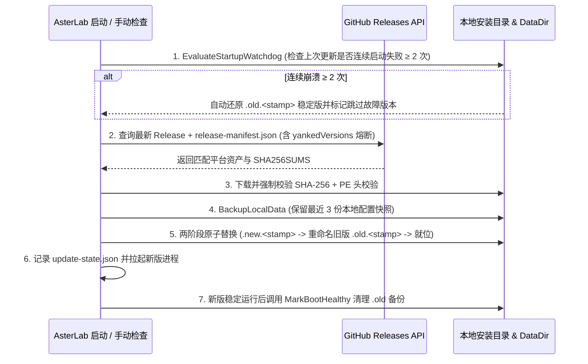

# 安装、升级与离线 AI 模型分发

AsterLab 桌面端采用 **Pure-Go 原生可执行文件（零 WebView、零外部运行时依赖）** 交付，提供 Windows 安装包/便携版、macOS `.dmg` 与 Linux `.deb`/`.tar.gz`，并内置带 SHA-256 校验与启动看门狗自动回滚的应用内更新机制。

---

## 1. 各平台分发产物与安装方式

| 平台 | 分发产物 | 安装与数据目录 |
|---|---|---|
| **Windows (x64)** | `AsterLab-MyGo-<ver>-win-x64-setup.exe`（NSIS 用户级安装程序）<br/>`AsterLab-MyGo-<ver>-win-x64.zip`（便携免安装版） | 默认安装目录：`%LOCALAPPDATA%\Programs\AsterLab MyGo`<br/>无需管理员权限；自动注册 `.asterml` 双击关联与 `asterlab://` 深度链接 |
| **macOS (arm64 / x64)** | `AsterLab-<ver>-macos-*.dmg` / `.zip` | 拖入 `/Applications`；通过 GitHub Releases 下载更新 |
| **Linux (x64)** | `.deb` / `.tar.gz` | 纯 Go 单二进制运行（无 CGO 依赖） |

> [!NOTE]
> 当前预发布版本未购买商业代码签名证书（构建产物附带 `UNSIGNED.txt` 与 `SHA256SUMS`）。首次运行 Windows SmartScreen 提示时，请核对 Release 页 `SHA256SUMS` 后点击「更多信息 → 仍要运行」。

---

## 2. 本地构建与打包脚本（Windows）

所有构建脚本位于 `scripts/`：

```powershell
# 1. 标准轻装构建（仅 mygo-run.exe + asterlab.exe，零 DLL 依赖）
pwsh -File scripts/mygo-build.ps1 -Version "0.2.0-beta.1"

# 2. 携带离线 AI 语义路由器构建（自动校验 router.int8.onnx 的 SHA-256 并打包 onnxruntime.dll）
pwsh -File scripts/mygo-build.ps1 -Version "0.2.0-beta.1" -IncludeNLModel

# 3. 打包便携 ZIP（输出到 release/AsterLab-MyGo-<ver>-win-x64.zip）
pwsh -File scripts/mygo-package.ps1 -Version "0.2.0-beta.1"

# 4. 生成 NSIS 安装程序（若 dist/ 含模型包与 onnxruntime.dll，自动启用可选组件页！）
makensis /DVERSION="0.2.0-beta.1" scripts/mygo-installer.nsi
```

### NSIS 覆盖升级机制（[mygo-installer.nsi](../../scripts/mygo-installer.nsi)）

1. **写入权限预检**：安装前先在目标目录创建探针文件，避免误选只读系统目录导致半截失败；
2. **优雅关闭旧进程**：先请求旧版 `mygo-run.exe` 退出，超时再清理残留进程；
3. **`.old` 原子让位**：先将旧 `mygo-run.exe`、`asterlab.exe`、`onnxruntime.dll` 重命名为 `.old` 再释放新文件，绕过 Windows 资源管理器或杀毒软件短暂占用锁；
4. **可选离线 AI 组件页**：当构建阶段传入 `-IncludeNLModel` 时，安装程序自动展示组件选择页（核心程序必选，约 23 MB 的 `Offline AI Semantic Router` 可由用户按需勾选或取消）；卸载时仅清理安装目录内随包模型，**保留用户本地热升级目录与所有 `.asterml` 实验 Vault 数据**。

---

## 3. 应用内自动更新与看门狗回滚

源码位于 [internal/updater/updater.go](../../prototypes/mygo-run/internal/updater/updater.go) 与 [watchdog.go](../../prototypes/mygo-run/internal/updater/watchdog.go)。



核心可靠性保障：
- **SHA-256 强制校验与 PE 合法性检查**：下载产物必须通过 `SHA256SUMS` 哈希核对及 Windows `MZ` 可执行头验证后才允许替换；
- **全量回滚事务（`applyDirectorySwap`）**：两阶段替换任意一步失败立即自动还原所有已移动文件；
- **更新前本地数据备份**：自动备份 `pantry-ledger.json`、`update-prefs.json`、`onboarding.json`、`workspace-session.json` 至 `backups/pre-<ver>-<ts>/`（滚动保留最近 3 份）；
- **启动看门狗自愈（`EvaluateStartupWatchdog`）**：若新版本连续 2 次未能进入健康运行态，下次启动自动还原 `.old.<stamp>` 旧版并将问题版本写入 `SkippedVersion`，彻底杜绝升级变砖；
- **远端紧急撤回（`ReleaseManifest.YankedVersions`）**：支持在 Release 附带 `release-manifest.json` 紧急熔断已发现严重缺陷的版本。

---

## 4. 离线 AI 模型包分发、热升级与降级策略

大体积推理模型（`router.int8.onnx` ~22.87 MB）与 `onnxruntime.dll` 不提交至 Git 仓库，按如下**四级优先级**由 [nlengine/manifest.go](../../prototypes/mygo-run/internal/nlengine/manifest.go) 自动发现并校验 `onnx_sha256`：

1. **环境变量（开发 / A-B 测试）**：`ASTERLAB_NL_ROUTER_DIR`
2. **用户热升级目录（零重装升级推荐）**：`%LOCALAPPDATA%\AsterLab\models\nl-router\`
3. **随安装包内置目录**：`<mygo-run.exe 同级>\models\nl-router\`
4. **源码开发目录**：`prototypes/mygo-run/models/nl-router/`

- **免重编译热升级**：将新版模型包（`manifest.json` + `router.int8.onnx` + `vocab.txt` + `schemas.json`）放入 `%LOCALAPPDATA%\AsterLab\models\nl-router\` 后重启应用即可生效；删除该目录即瞬间回滚到安装包内置版本。
- **零模型优雅降级**：若上述目录均未找到合法模型包，或哈希校验未通过，或当前平台暂无 `onnxruntime.dll`，AsterLab 绝不报错崩溃，自动无缝降级为 `< 1 ms` 纯 Go 确定性规则引擎。

---

## 5. 数据安全与备份边界

- **实验数据与程序完全解耦**：卸载、覆盖安装或应用内自更新**永远不会触碰**用户选择的 Vault 目录（`.asterml` 文件、实验照片与 `.asterlab/snapshots` 恢复快照）；
- **索引缓存可随时重建**：`.asterlab/cache/index.json` 为纯加速缓存，升级或迁移电脑时仅需同步或复制 `.asterml` 文档与 `assets/` 图片即可完整恢复全部实验数据。
