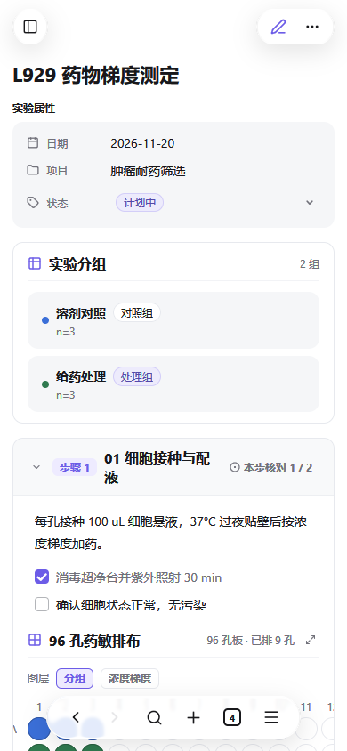
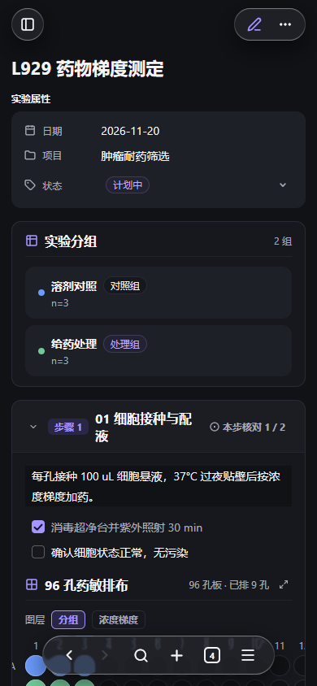
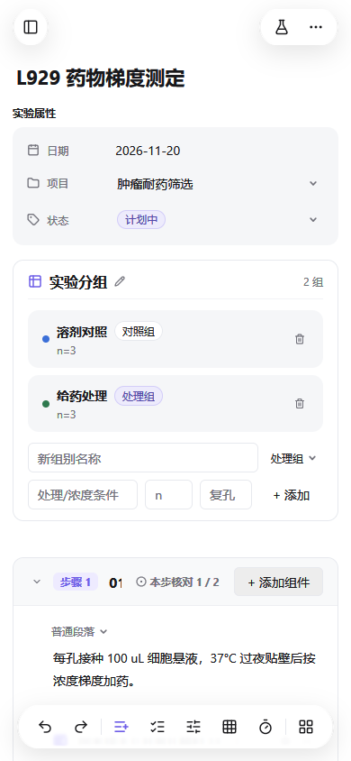
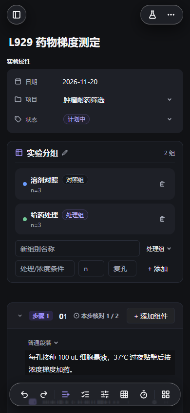
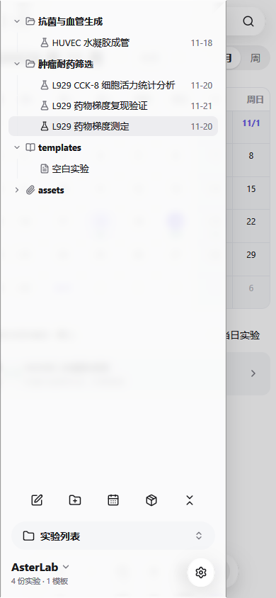
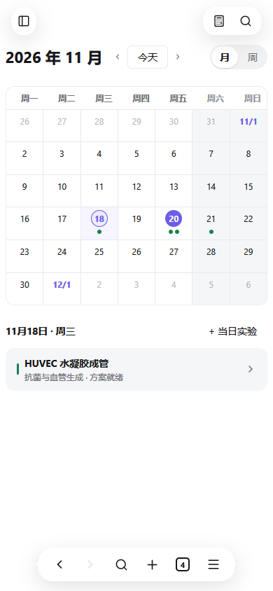
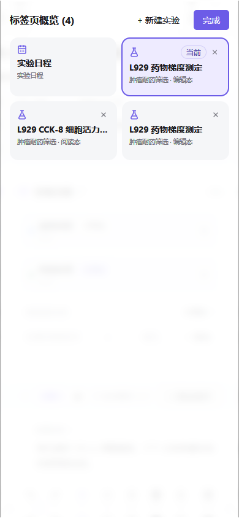

# 移动端单手工作台

当视口宽度小于 `680dp`、运行于 `android` / `ios` 系统，或在设置中开启移动预览模式时，[mobile.go](../../prototypes/mygo-run/internal/shell/mobile.go) 会自动切换至针对实验台单手握持优化的响应式工作台布局。

## 核心交互设计规范

1. **顶部视野释放与浮动操作钮**
   - 取消桌面端占据整行宽度的标题栏，正文顶部区域使用 `ScrollEdgeSoft` 羽化处理，使实验大标题直接作为内容首行呈现。
   - 左上角悬浮一枚 `40×40` 圆形独立抽屉按钮，右上角收拢一枚双图标合并药丸（文档视图为 `[编辑/实验模式切换 | ⋯]`，日程视图为 `[速算 | 搜索]`）。
2. **纯图标居中底部浮岛与滚动隐匿**
   - **导航模式底条**：在底部居中悬浮高 `48dp`（圆角 `24`）的 Liquid Glass 胶囊，仅放置 6 枚细线图标：**`< · > · 🔍 · + · [N] · ≡`**，避免文字按钮在窄屏下折行或挤压触控热区。
   - **滚动自适应收放**：当页面向下滚动超过 `36dp`（`curY > 36 && dy > 6`）时底栏平滑下滑隐匿以让出最大阅读面积；向上轻拉（`dy < -4`）、回滚至顶部（`curY <= 12`）或轻点底部唤醒条时立即弹回。
   - **编辑模式底条**：切换至编辑态时平滑切换为同尺寸纯图标操作条（`↶ ↷ | +步骤 ☑ ⊞ ⬡ ⏱ | ⊞` 切回导航）。
3. **无边框 `Tok.Elevated` 卡片与紧凑日程网格**
   - 实验属性与窄屏 `group_table` 分组行统一渲染为无 1px 外描边的 `Tok.Elevated`（`#f5f6f8` / `#1e2027`）`R14` 软灰卡片，靠纯净微弱的背景反差分隔信息层。
   - 移动端月历每格紧凑展示日期与实验圆点状态，月初首日固定使用 `11/1`、`12/1` 格式以免在 390px 屏宽下换行。
4. **边缘跟手滑动抽屉与三层底部控制岛**
   - 屏幕左右边缘各保留 `18dp` 滑动热区（`mobileEdgeSwipeZoneWidth = 18`），通过 `Dragged()` 与 `DragVelocity()` 驱动左文件库（上限宽度 `320dp`）与右大纲/速算抽屉跟手滑入。
   - 文件库抽屉底部采用三层结构收拢高频工具：5 枚常用纯图标动作 → `[📁 实验列表 ↕]` 模式切换条 → 左下 `Vault / 文件统计` 与右下独立 `40dp` 圆形 `⚙` 设置钮。
5. **页签卡片网格概览与顶部下拉快捷动作**
   - 点击底部 `[N]` 图标呼出双列页签概览网格，支持单卡点击跳转或点 `×` 关闭。
   - 在页面顶端（`Y <= 2`）继续向下阻尼拖拽超过 `56dp`（`mobilePullActionThresh = 56`）即可触发可配置快捷动作（默认为打开命令面板，可在设置中改为「新建今日实验」「速算与计时器」或「展开实验库」）。

## 移动端多场景实拍对照

| 移动端阅读态（默认纯白 Light） | 移动端阅读态（深空曜石 Dark） | 移动端编辑态底条（Light） | 移动端编辑态底条（Dark） |
|---|---|---|---|
|  |  |  |  |

| 侧滑文件库抽屉与三层底岛 | 移动端实验日程月历与当日卡片 | `[N]` 双列标签页卡片概览 |
|---|---|---|
|  |  |  |
