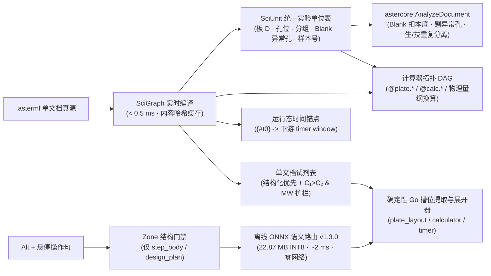

# SciGraph 科学网络、离线 AI 路由与孔板排版引擎

AsterLab 在 `.asterml` 单真源之上构建了一套**「厚代码科学引擎（`SciGraph`）+ 轻模型语义传感器（`nlengine`）+ 确定性算法排版器（`plate_layout`）」**三层协同系统，使普通科研文字本身即可安全驱动孔板、计算器、计时器、采图网格与统计分析，而绝不把实验数据的准确性赌在黑盒大模型上。

---

## 1. SciGraph：单文档响应式科学语义网络与 `internal/scimath` 计算引擎

源码位于 [scigraph.go](../../prototypes/mygo-run/internal/asterdoc/scigraph.go)、[calc_eval.go](../../prototypes/mygo-run/internal/asterdoc/calc_eval.go) 及独立的零 UI 单位换算与公式求值引擎 [internal/scimath](../../prototypes/mygo-run/internal/scimath/)（`units.go` + `expr.go`）。

### 1.1 严格单文档动态加载边界

- `SciGraph` **严格限定在当前打开的单篇 `.asterml` 文档内实时编译**，按文档内容 SHA-256 哈希缓存（编译 `< 0.5 ms`，查询 `~5 µs`）。
- 跨文档引用一律使用显式、可审计的 `[[...]]` / `![[...]]` 语法，绝不做隐式跨文件抓取，避免历史废稿污染当前实验参数。
- 任意句子调用 `SciGraph.ContextAt(offset)` 时，只读取阅读顺序上位于该行之前的上下文（`offset <= 当前行`）。

### 1.2 统一实验单位（`SciUnit`）全链消费

`SciGraph` 自动为文档中每个已分配孔位构建一行 `SciUnit`（`PlateID`、`Well`、`GroupID`、`GroupName`、`Role`、`IsBlank`、`Excluded`、`SampleID`），所有下游模块消费同一份真值，杜绝数据孤岛：

| 消费者 | 消费行为 |
|---|---|
| **孔板容器 (`plate@1`)** | 区分「已分配孔板 (`Assigned=true`)」与「未分配空板 (`Assigned=false, SampleWells=0`)」；标记 `role: blank`（空白孔）与 `excluded_wells`（异常孔，如污染/气泡） |
| **计算器 (`calculator@1`)** | `@plate.sample_wells`、`@plate.<id>.sample_wells`、`@plate.all_sample_wells`、`@group.<id>.wells` 自动剔除空白孔与异常孔；指向未分配空板时直接报明确错误，绝不静默按 96 孔满板算配液 |
| **采图网格 (`attachment@1`)** | 按 `SciUnit` 自动生成槽位并跳过已标记 `excluded_wells` 的异常孔 |
| **数据表 (`data_table@1`)** | 矩阵粘贴自动映射分组与样本号，并自动跳过异常孔 |
| **统计核心 (`astercore.AnalyzeDocument`)** | 按 `container_ref` / `plate_id` 查 `SciUnit`：自动剔除 `excluded_wells`（记录 `ExcludedN`）、分离 `Blank` 孔计算本底均值（`BlankN` / `BlankMean` / `BlankCorrMean`），并显式区分技术复孔数（`TechReplicates`）与独立生物学重复数（`BioSamples`） |

### 1.3 计算器级联 DAG 与物理量纲护栏

- **拓扑级联**：下游计算器可通过 `@calc.<module_id>.<row_key>` 直接引用上游计算器输出行（如前驱液总体积 `V_tot` → 冻干粉称量 `m_gelma`）；UI 提供一键「`+ 引用上游计算 ▾`」菜单，并内置防环保护。
- **同量纲自动换算**：支持体积（`nL / µL / mL / L`）、质量（`ng / µg / mg / g`）、质量浓度（`ng/mL / µg/mL / mg/mL / g/L`）、摩尔浓度（`nM / µM / mM / M`）、时间（`s / min / h`）自动换算（例如上游输出 `5400 µL`，下游以 `mL` 接收时自动换算为 `5.4 mL` 并记录换算轨迹）。
- **跨量纲硬阻断**：当上游输出与下游输入量纲不兼容（例如把质量 `mg` 当作体积 `mL` 引用）时，立即阻断求值并返回可读错误，绝不静默产生错误配液数值。
- **稀释母液继承物理护栏**：
  - 文档内纯文本试剂收割仅认母液关键词（`母液 / 储液 / 原液 / stock / 浓缩液 / MW`），主动屏蔽「工作浓度 / 终浓度」描述，且上游结构化模块始终优先于纯文本；
  - 稀释公式继承强制校验 **`C₁ > C₂`**；
  - 跨越质量浓度与摩尔浓度（如 `mg/mL` → `µM`）时，若缺少分子量 `MW` 则显式列入 `MissingSlots` 提醒补全，存在 `MW` 时自动通过 `µM = (mg/mL) × 10⁶ / MW` 精确换算。

### 1.4 运行态时间锚点（`{#t0}`）自动唤醒

在步骤标题标注 `{#t0}`（或其他锚点 ID）后，当该步骤内计时器启动/完成（或点击「标记此刻为 t0」）写入真实时间戳，同文档所有绑定 `anchor: t0` 的下游时间窗模块（`timer@1` `mode: window`）自动唤醒，计算精确墙钟目标时刻与剩余倒计时。

---

## 2. 离线端侧 AI 语义路由器（NL-Router v1.3.0）

源码位于 [internal/nlengine](../../prototypes/mygo-run/internal/nlengine/) 与 [nl_router_onnx.go](../../prototypes/mygo-run/internal/asterdoc/nl_router_onnx.go)。完整升级与重训手册见 [`docs/sdk/nl-router-upgrade.md`](../sdk/nl-router-upgrade.md)。

### 2.1 纯 Go 零 CGO 架构与结构门禁

- **零网络、纯离线推理**：通过 `syscall.NewLazyDLL` 直接调用标准 C ABI `OrtGetApiBase()->GetApi(17)` 驱动 `onnxruntime.dll`（兼容 ORT 1.17–1.25+），搭配纯 Go WordPiece 分词器运行约 **22.87 MB** 的 INT8 动态量化双塔编码器（`BAAI/bge-small-zh-v1.5` 蒸馏），单次路由延迟 **~1.7–2.2 ms**。
- **Zone 确定性结构门禁**：`Alt + 悬停` 仅在 `step_body`（操作步骤正文）与 `design_plan`（设计规划句）生效；标题、Frontmatter、元数据属性行、耗材清单与复盘讨论区由 AST 直接静音，绝不乱弹窗。
- **优雅降级**：若运行环境未携带模型包或 `onnxruntime.dll`（如 Linux CI 或未勾选 AI 组件的轻装版），自动无感退化至 `< 1 ms` 确定性本地规则路由，主程序全部功能正常运行。

### 2.2 能力边界：Zero-Shot 路由 vs 确定性展开器

> [!IMPORTANT]
> **必须明确区分「意图路由」与「组件展开」两层边界**：
> - **意图路由层（Zero-Shot 即插即用）**：只要在 `spec/nl_schemas.json` 新增或修改某个模块的语义描述，Go 启动时会自动比对 `desc_hash` 并即时用本地 ONNX 编码新向量，**无需重训模型**即可完成语义命中；
> - **参数提取与模块生成层（确定性 Go 展开器）**：最终写入 `.asterml` 的精确数据结构、物理量纲换算与校验逻辑由 Go 展开器（`nl_suggest.go`、`plate_layout.go`）负责。因此新增一类可一键生成的组件时，仍需配套对应的确定性 Go 槽位提取与展开代码，确保科学计算 100% 可复现。

### 2.3 通用计算器公式库（人机协同）

针对所有湿实验高频公式，`calculator@1` 保持唯一通用组件契约，内置 9 套通用公式模板（`C₁V₁=C₂V₂ 稀释`、`比例稀释 1:N`、`连续倍比稀释`、`% w/v 称量`、`摩尔称量`、`孔板预混`、`细胞接种`、`RCF↔RPM 离心力`、`自定义 LaTeX`），支持失焦自动提交与点击公式一键复制 LaTeX。当句子意图明确但公式不唯一时，先将抽取的科学变量填好，公式交由科研人员 1 秒选定。

---

## 3. 确定性孔板排版引擎（`plate_layout.go`）

源码位于 [plate_layout.go](../../prototypes/mygo-run/internal/asterdoc/plate_layout.go)。

- **模型提规格，算法排坐标**：AI/规则只提取逻辑规格（板型 `6/12/24/48/96/384`、分组与复孔数、是否显式要求边缘防蒸发），物理孔位坐标 **100% 由确定性算法顺排生成**，**不做自动区组随机化**（符合湿实验顺手移液习惯）。
- **默认不强制外周留空 + 多板自动溢出**：
  - 默认按行顺排、不占用外周空白；仅当用户显式开启「外周留空防蒸发（PBS）」时才自动预留外圈（96 孔板保留中间 60 孔；12 孔板预留第 4 列 3 孔）；
  - 当总实验孔数超出单板可用容量时，**绝不静默丢孔**：新建时自动拆分为多块孔板，右键对既有孔板切换排版时则明确提示超出孔数。
- **右键菜单一键重排与已录数据锁**：
  - 孔板右键菜单提供「按行顺排（横排）」「按列顺排（竖排 · 8 道排枪）」「切换外周留空防蒸发（PBS）」；
  - **已录数据安全锁（`PlateHasRecordedData`）**：一旦该孔板已经存在异常孔标记（`excluded_wells`）、孔位样本编号（`samples`）、关联读数（`data_table`）或关联采图（`attachment`），自动重排将被强制锁定，防止静默重排导致历史数据归组错乱。

---

## 4. 实验文档的科研心智分工

在五学科全流程协议实践（HUVEC 成管、RT-qPCR、Western Blot、CCK-8 IC50、免疫荧光共聚焦，见 `prototypes/mygo-run/testdata/protocols/01..05_*.asterml`）中，AsterLab 推荐统一的**「顶部蓝图 → 步骤就地工具」**书写心智：

| 文档区域 | 放什么 | 为什么 |
|---|---|---|
| **顶部：实验设计蓝图** | 跨步骤共享的静态对象：`group_table`（实验分组）、`plate`（孔板布局）、试剂母液清单与关键参数 | 科研人员先看清全局对照、样本量与孔板排布，不把冗长计算与读数表堆在开头 |
| **中部：按时间线的实验步骤（`#@`）** | 该步骤现场要用的动作工具：`calculator`（配液/稀释）、`timer`（计时与 `{#t0}` 窗口）、`attachment`（采图）、`checklist`（关键质控点） | 做到哪一步，工具就在哪一步就地展开，靠 `SciGraph` 自动继承顶部孔板与母液事实 |
| **尾部：结果与统计** | `data_table` 读数录入与 `astercore` 自动生成的统计摘要卡片 | 保持实验设计、过程执行与结果分析在同一份 `.asterml` 文件内完整闭环 |
