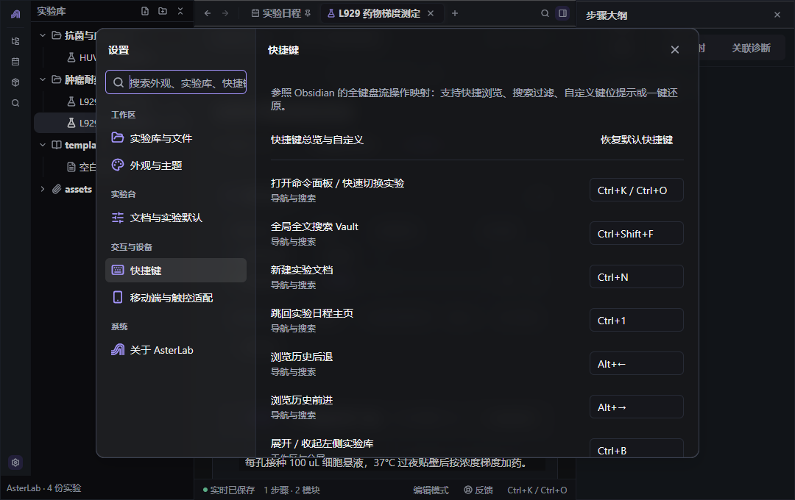
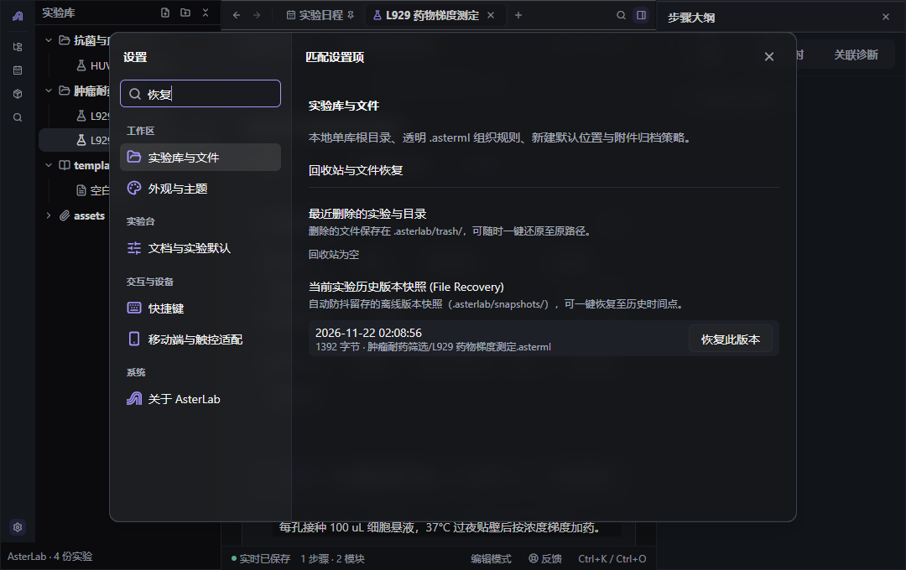

# 自动化校验门禁与已知优化热点

本页汇总日常修改代码与调整 UI 样式后的必跑校验门禁、近期已验证关闭的缺陷与实图证据，以及后续仍可持续打磨的演进热点。

## 必跑自动化门禁命令

### 1. AsterML v2 契约一致性校验

```powershell
python scripts/sdk/check.py
```

校验 `modules.json` 清单（21 模块 / 21 kind / `sdk 2.0.0`）、Go 注册一致、规则与端口对齐以及规则覆盖。

### 2. 全量 Go 包（含 `cmd/asterlab` CLI）、构建与视觉目录截图刷新

```powershell
$env:ASTERLAB_VISUAL_DIR = "$PWD\docs\sdk\evidence\v2-visual-catalog"
Push-Location prototypes/mygo-run
go test -p=2 -count=1 ./internal/... ./cmd/...
go test -p=2 -count=1 -run "TestObsidianVaultInteractiveExperienceAndVisualCatalog|TestVisualArchiveSettingsMobileAndContextMenus|TestV2WorkbenchVisualGate|TestUnifiedLivePreviewLabModeAndInlineRelations" .
go build ./...
Pop-Location
```

### 3. Design System 调用点合规扫描（新代码零违规）

```powershell
rg -n "ui\.Hex\(|ui\.RGBA\(|FontSize\([0-9]|Radius\([0-9]" prototypes/mygo-run/internal/shell/ prototypes/mygo-run/internal/asterdoc/ prototypes/mygo-run/experiment_page.go prototypes/mygo-run/vault_host.go
```

## 近期已解决热点（近期核心演进验收闭合）

| 已关闭问题 | 修复实现 | 验证状态 |
|---|---|---|
| **移除对 `Runs.dll` / SQLite 的运行依赖** | [main.go](../../prototypes/mygo-run/main.go) 移除 `a.syncErr` 报错条，Pure-Go Vault + `astercore` 全面独立闭环 | **已解决** |
| **Dark 模态弹窗底色透射重影** | [settings.go](../../prototypes/mygo-run/internal/shell/settings.go) 与 [command_palette.go](../../prototypes/mygo-run/internal/shell/command_palette.go) / [search_modal.go](../../prototypes/mygo-run/internal/shell/search_modal.go) 统一铺设 `tok.Surface` 实底与 `tok.BorderStrong` 边框（见下方修复后实图） | **已解决** |
| **用户快捷键不生效与源码 `Ctrl+Z` 冲突** | [hotkeys.go](../../prototypes/mygo-run/internal/shell/hotkeys.go) 实现规范键位匹配，[live_doc.go](../../prototypes/mygo-run/internal/vault/live_doc.go) 增加 800ms 源码输入撤销防抖 | **已解决** |
| **孔板浓度因子色阶冲突与 PNG 空导出** | [plate.go](../../prototypes/mygo-run/internal/uikit/plate/plate.go) 启用数值单调梯度渐变；[plate_png.go](../../prototypes/mygo-run/internal/asterdoc/plate_png.go) 实现纯 Go 孔板 PNG 导出 | **已解决** |
| **统一科学笔记编辑器（Obsidian Live Preview + 实验防误触模式 + 行内关联语法 + Agent 命令总线）** | [live_markdown.go](../../prototypes/mygo-run/internal/asterdoc/live_markdown.go)、[relations.go](../../prototypes/mygo-run/internal/asterdoc/relations.go)、[embed_card.go](../../prototypes/mygo-run/internal/asterdoc/embed_card.go)、[internal/astercmd](../../prototypes/mygo-run/internal/astercmd/)、[cmd/asterlab](../../prototypes/mygo-run/cmd/asterlab/main.go) 全量闭环并通过视觉与单测门禁 | **已解决** |

### Dark 模态弹窗修复后实拍证据

| 修复后 Dark 快捷键设置弹窗（无透底重影） | 修复后 Dark 文件恢复设置弹窗 |
|---|---|
|  |  |

## 当前持续演进热点

*(涉及立项排期时须按仓库规则先在 Kandev 建卡，此处只记录代码现状与演进方向：)*

| 热点类别 | 对应源码 | 现状描述与优化方向 |
|---|---|---|
| **双端并发修改结构化三路合并 UI** | [live_doc.go](../../prototypes/mygo-run/internal/vault/live_doc.go) | 已具备 `ReloadIfExternalChanged()`、`.asterlab/snapshots/` 快照及 `WriteFileAtomic` 保护，后续可补充基于 `step.id` / `block.id` 的自动三路合并与并发冲突对比视图。 |
| **历史遗留包 Token 债务** | [docs/product/design-system.md](../product/design-system.md) | `UnifiedLive` 新文档路径与 `shell`/`theme` 已完全收口 Tokens，旧包（`internal/runui`、`internal/runworkspace`、`internal/resultgrid`）待分批退场或清理字面值。 |
| **真机软键盘 Inset 与原生真长按** | [mobile.go](../../prototypes/mygo-run/internal/shell/mobile.go) | 编辑底条与窄屏横滑已适配；待底层 `mygo/ui` 对 Android/iOS 暴露虚拟键盘安全区高度与原生 `OnLongPress` 回调后可自动抬升工具条。 |
| **移动端 390px 周时间网格** | [calendar.go](../../prototypes/mygo-run/internal/shell/calendar.go) | 月视图已针对窄屏优化，`renderAppleWeekTimeGrid` 七列周网格在 390px 屏宽下仍可进一步优化紧凑滑览体验。 |
